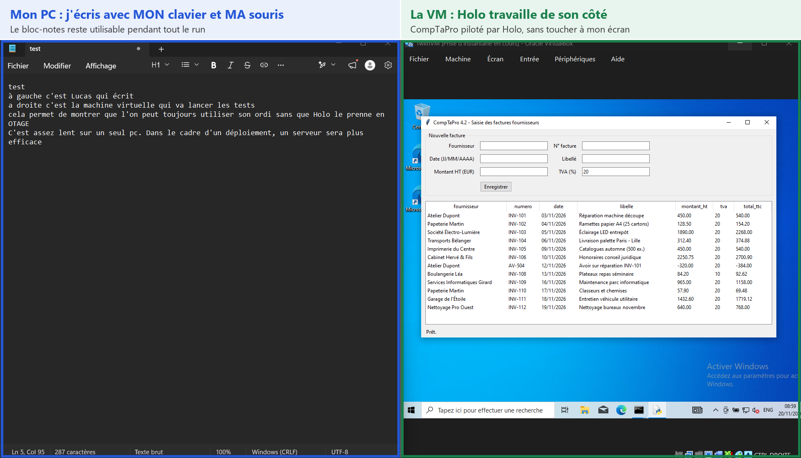
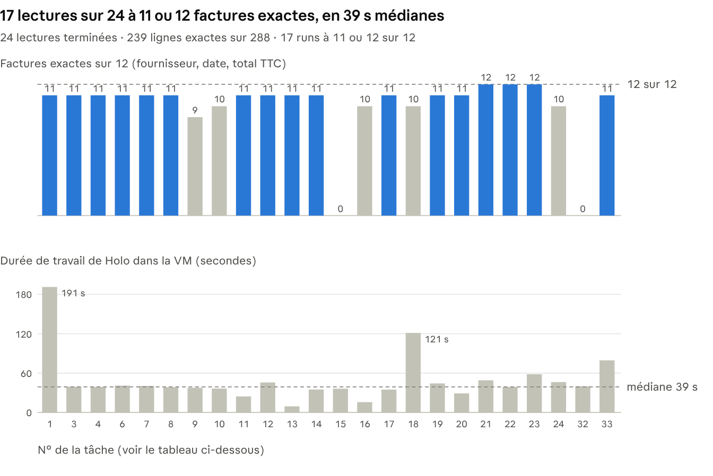
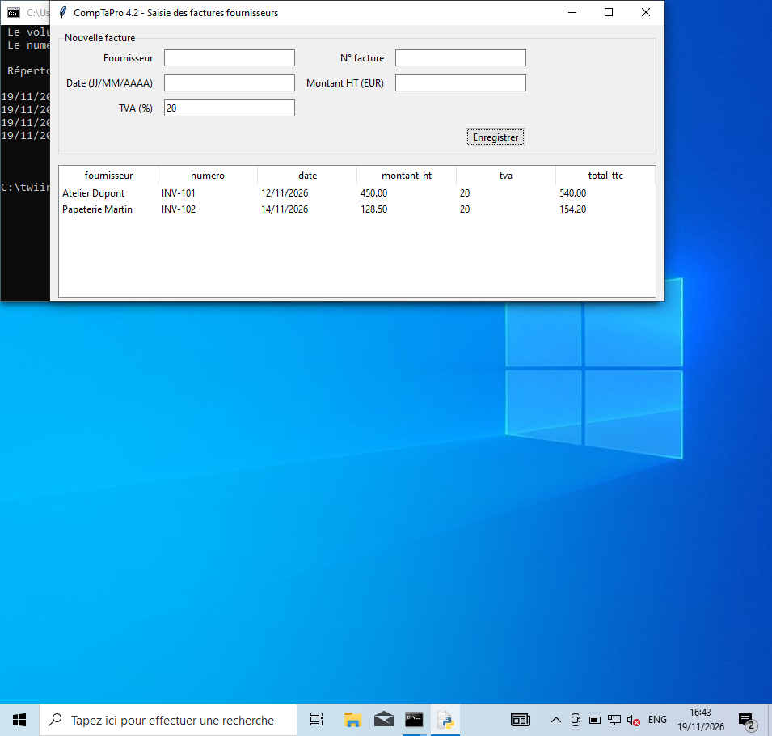
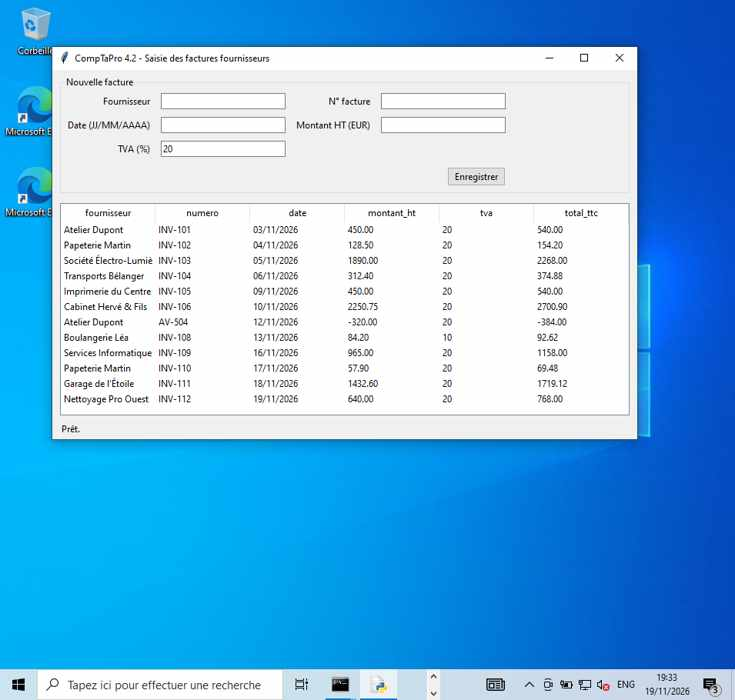

# Holo dans une machine virtuelle : le poste de l'employé reste libre

Preuve de concept réalisée les 19 et 20 novembre 2026 · Lucas

> Ce dossier contient la documentation et les preuves de la partie VM. Le code de la VM (module de liaison, scripts, travailleur) est resté sur le PC de test et n'est pas publié ici.

## En bref

Quand Holo pilote un logiciel de bureau, il prend l'écran, la souris et le clavier de l'employé, qui ne peut plus travailler. **En faisant travailler Holo dans une machine virtuelle (VM), l'employé garde son poste.** Ce qui est prouvé sur le PC de test (Windows 11 Famille, 16 Go) :



À gauche, Lucas écrit dans son bloc-notes avec son clavier et sa souris ; à droite, la VM où Holo pilote CompTaPro de son côté (20/11).

**Pourquoi une capture et pas une vidéo.** Sur un seul PC de 16 Go, la VM consomme beaucoup de ressources (4 Go de mémoire, un processeur sous l'hyperviseur Windows) : filmer en même temps ralentit tout et donnerait une démo peu représentative. Sur un serveur hébergé (voir la dernière section), cette contrainte disparaît.

- Holo a lu les 12 factures d'un logiciel de bureau sans API (CompTaPro) dans la VM, en 39 secondes médianes, avec 11 ou 12 lignes sur 12 exactes dans la plupart des runs.
- Pendant un run de 5 minutes, l'employé a fait 581 mouvements de souris et 1 289 frappes sur son PC, et le curseur du PC n'a jamais été déplacé par Holo.
- Le bouton « Lancer l'automatisation » de Twiin envoie la tâche à la VM : Twiin déduit la mission de l'enregistrement, n8n la transmet, la VM la fait et rend un rapport.

Ce qui n'est pas encore prouvé : faire saisir par Holo, dans la VM, les données lues dans un second logiciel (voir Limites).

## Pourquoi une machine virtuelle

Twiin a déjà un navigateur invisible pour les logiciels web : Holo y travaille sans toucher à l'écran. **Un logiciel de bureau sans API, lui, ne s'ouvre que sur un vrai écran.** Holo doit alors voir les fenêtres, déplacer la souris et taper au clavier, donc il bloque le poste de l'employé le temps de la tâche.

La VM donne à Holo son propre écran, sa propre souris et son propre clavier. Le logiciel métier y est installé comme sur un poste normal. L'employé continue à travailler sur son PC pendant que Holo travaille dans la VM, à côté ou en arrière-plan.

## Comment ça marche

```
PC de l'employé                    Internet                      VM (VirtualBox, Windows 10)
┌──────────────────────┐          ┌──────────────┐               ┌───────────────────────────┐
│ Twiin                │          │ Supabase     │               │ Travailleur               │
│  « Lancer l'automat. »│──► n8n ─►│ table vm_jobs│◄── interroge ─│  remet CompTaPro à zéro   │
│ Page de trace        │◄─────────│ (boîte aux   │── rapport ───►│  lance Holo               │
└──────────────────────┘          │  lettres)    │               │ Holo ⇄ API Holo (captures)│
                                  └──────────────┘               └───────────────────────────┘
```

Twiin passe la mission à n8n, qui la dépose dans Supabase et réveille la VM. Le travailleur de la VM la prend, fait travailler Holo sur CompTaPro (Holo envoie chaque capture à son API et reçoit l'action suivante), puis dépose le rapport dans Supabase, où n8n et la page de trace le lisent.

## Le connecteur : du bouton Twiin à Holo dans la VM

**Un clic sur « Lancer l'automatisation » dans Twiin suffit : Twiin envoie lui-même la tâche à la VM.** Le connecteur est un petit module ajouté à Twiin, qui ne modifie rien d'autre.

1. **Twiin intercepte le clic.** Si le mode VM est activé (un fichier de réglage, désactivable en un mot), le clic part vers la VM au lieu de l'automatisation habituelle.
2. **Twiin rédige la mission à partir de l'enregistrement.** Il relit ce qu'il a compris de la tâche de l'employé et en tire le logiciel à piloter, ce qu'il faut lire et les colonnes, dans l'ordre où elles apparaissent à l'écran.
3. **Garde-fou.** Si le logiciel déduit n'est pas installé dans la VM, Twiin garde la dernière mission valide au lieu d'envoyer une mission impossible. C'est arrivé en test : l'enregistrement a été compris comme « ComptaFaire » au lieu de « CompTaPro ».
4. **n8n prend le relais.** Le workflow crée la tâche dans une table Supabase, réveille la VM si elle est en pause, attend le rapport, puis range les lignes lues dans une table de suivi.
5. **La VM exécute.** Un programme « travailleur » y attend les tâches. Il remet le logiciel dans son état de départ, le met au premier plan, lance Holo, puis renvoie les lignes lues, le journal des étapes et une capture finale.
6. **L'employé voit le résultat.** Une page de trace s'ouvre sur son PC et se met à jour toute seule pendant le run.

Pourquoi Supabase entre les deux : la VM ne peut pas joindre le PC directement (le réseau de VirtualBox, sous l'hyperviseur Windows, bloque ce chemin), mais elle a Internet. Supabase sert de boîte aux lettres, et c'est aussi le schéma d'une version hébergée.

## Ce qui a été mesuré

**Sur 33 tâches envoyées à la VM, Holo a terminé 24 lectures, en 39 secondes médianes, avec 239 lignes exactes sur 288 (83 %) ; 17 de ces lectures ont 11 ou 12 factures exactes sur 12.** L'exactitude est vérifiée en comparant les lignes rendues au fichier réel du logiciel, pas à ce que Holo déclare. Le détail tâche par tâche est dans [journal-des-runs.md](journal-des-runs.md).



| Date | Test | Durée de Holo | Résultat |
| --- | --- | --- | --- |
| 20/11 | Lecture des 12 factures avec libellés, VM remise en état | 79 s | 11/12 exactes (une date mal lue) |
| 20/11 | Lecture, mission déduite par Twiin de l'enregistrement | 24 s | 11/12 exactes |
| 20/11 | Lecture avec la nouvelle colonne Libellé | 49 s | 11/12 avec le libellé (un libellé avec une faute), 12/12 sur fournisseur, date et montant |
| 19/11 | Lancement par n8n, VM en pause au départ | 82 s du clic au résultat | 11/12 exactes, 12 lignes rangées dans la table de suivi |
| 19/11 | Lecture après ajout de la fin automatique | 39 s, 6 étapes | 11/12 exactes |
| 19/11 | Première lecture via Supabase | 191 s, 27 étapes | 11/12 exactes |
| 19/11 | Saisie de 2 factures dans CompTaPro, dans la VM | environ 5 min | 2/2 exactes |

**Poste libre, mesuré pendant la saisie du 19/11 :** sur 5 minutes, 581 mouvements de souris et 1 289 frappes ont été comptés sur le PC (sans enregistrer les touches). Pendant 50 secondes où Holo cliquait et tapait dans la VM, le curseur du PC n'a pas bougé d'un pixel.

## Captures

**1. Holo a saisi deux factures dans CompTaPro, à l'intérieur de la VM (19/11).** Les deux lignes sont exactes ; pendant ce temps, le PC a enregistré 581 mouvements de souris et 1 289 frappes de l'employé.



**2. L'écran de la VM à la fin d'une lecture lancée par n8n (19/11, 19 h 33).** La VM était en pause au départ : elle s'est réveillée, le travailleur a remis CompTaPro au premier plan avec ses 12 factures, et Holo les a lues. Capture envoyée par la VM dans son rapport.



## Limites et ce qui n'a pas marché

**La lecture est fiable à 11 lignes sur 12 ; la tâche complète (lire puis ressaisir ailleurs) n'est pas encore au point.**

- **Recopie vers un second logiciel : échec.** Le 20/11 au matin, 5 essais de recopie de 2 factures de CompTaPro vers un « registre de trésorerie », dans la VM, n'ont jamais abouti. L'API Holo a répondu « requête invalide » en cours de route, sans qu'on puisse reproduire l'erreur hors de la VM. Cause non trouvée.
- **QONTA (logiciel web) depuis la VM : impossible.** La VM ne joint pas le PC, ni par l'adresse habituelle de VirtualBox ni par un relais sur l'adaptateur réseau privé.
- **Erreurs de lecture.** Un nom coupé à l'écran est lu coupé (corrigé en élargissant la colonne). Une fois, l'avoir « AV-101 » a été « corrigé » en « INV-107 » (renommé « AV-504 » depuis). Quand une fenêtre cachait le tableau, Holo a inventé des lignes : le travailleur met désormais le logiciel au premier plan avant chaque tâche.
- **Holo ne sait pas toujours s'arrêter.** Un run a tourné jusqu'au plafond de 40 étapes (354 s) après avoir tout lu. Le travailleur arrête maintenant la lecture après 5 étapes sans nouvelle ligne.
- **La VM dépend du PC.** Sous l'hyperviseur Windows, VirtualBox est lent : installation de Windows 11 impossible (Windows 10 à 1 cœur), démarrage à froid d'environ 8 minutes, instantané de la VM bloqué. Quand le PC n'avait presque plus de mémoire libre, un run a pris 121 s au lieu de 40.
- **Pilotage de la VM au clavier.** Sans les outils VirtualBox fonctionnels dans la VM, les mises à jour s'y font en tapant des commandes à distance, ce qui perd des caractères sur une VM chargée.

## En entreprise : ce que la DSI mettrait en place

**Une VM sur le PC de chaque salarié ne sert qu'à la preuve de concept ; en entreprise, ce serait un parc de VM géré par la DSI** (dans le cloud, par exemple Azure Virtual Desktop ou Windows 365, ou sur ses serveurs). Le salarié valide une automatisation, une VM est créée pour la tâche, Holo y travaille, la VM s'éteint.

1. **Une image Windows de référence** avec les logiciels métier installés, et les licences qui vont avec.
2. **Des comptes de service pour le robot**, jamais les mots de passe des salariés, avec les droits minimum et une coupure possible en un clic.
3. **Un coffre à secrets côté serveur** pour les clés Holo et les accès aux logiciels.
4. **Un réseau restreint** : la VM n'atteint que les logiciels autorisés et l'API Holo.
5. **L'autorisation des logiciels, une seule fois** : la DSI dit quels logiciels Twiin peut piloter.
6. **Traces et conformité** : journal des actions de Holo et captures conservées une durée limitée (RGPD), car elles peuvent contenir des données clients.
7. **Des VM à la demande**, créées pour la tâche puis supprimées, pour maîtriser le coût.

Dans la version hébergée, le rôle de boîte aux lettres de Supabase et la page de trace restent les mêmes ; seuls la VM et n8n passent côté serveur.

## Prochaines étapes

- [ ] Trouver la cause des refus de l'API Holo depuis la VM, puis réussir la tâche complète : lire dans CompTaPro et ressaisir dans un second logiciel.
- [ ] Faire ressaisir les lignes lues dans QONTA par le navigateur invisible de Twiin, côté PC, en attendant que la VM puisse joindre le réseau.
- [ ] Faire le test sur une VM hébergée (sans l'hyperviseur Windows du PC) pour mesurer le gain de vitesse et de stabilité.
- [ ] Tester un modèle Holo sans limite de 10 requêtes par minute, qui impose aujourd'hui 6,5 s d'attente par étape.
- [ ] Intégrer le connecteur dans le générateur d'automatisations de Twiin, comme brique « Holo dans la VM » pour tout outil classé « écran ».
- [ ] Resserrer les règles d'accès Supabase des tables de test, ouvertes pour l'essai.

## La solution finale : un serveur hébergé, pas une VM sur le poste

**La VM sur le PC n'est pas la cible : c'est le moyen choisi pour démontrer le but premier, que l'employé garde son ordinateur pendant que Holo travaille.** Elle a permis de le prouver vite, sans infrastructure, avec des chiffres.

La solution finale fait tourner l'environnement de Holo **sur un serveur hébergé** (poste virtuel dans le cloud ou serveur de l'entreprise), pas sur le PC du salarié. Rien à installer sur son poste, aucune mémoire prise sur sa machine, et la DSI gère les logiciels, les accès et la sécurité en un seul endroit. Le principe démontré ici reste le même : Twiin lance la tâche, Holo la fait ailleurs que sur l'écran de l'employé, et un rapport revient.

## Contenu du dossier

| Chemin | Contenu |
| --- | --- |
| `README.md` | Ce document |
| `journal-des-runs.md` | Les 33 tâches envoyées à la VM, une par ligne, et la méthode de mesure |
| `captures/` | Les captures de ce document et le graphique des runs |
| `preuves/` | Les données brutes (CSV, JSON, mesure souris/clavier) et les logs ; voir `preuves/README.md` |
