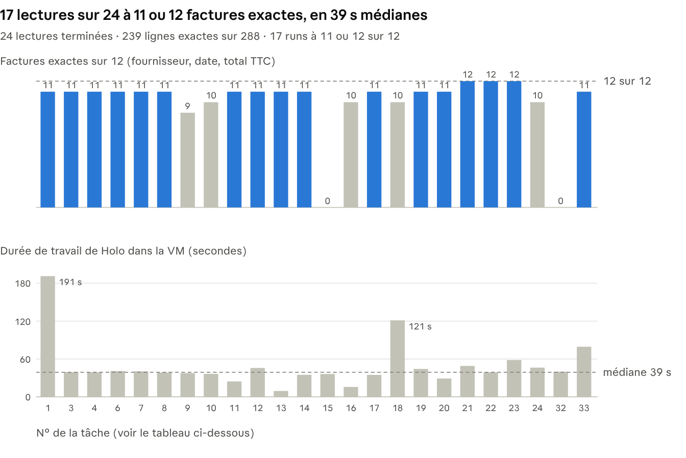

# Journal des runs de la VM

**Sur 33 tâches envoyées à la VM les 19 et 20 novembre 2026, Holo a terminé 24 lectures de CompTaPro, en 39 secondes médianes, avec 239 lignes exactes sur 288 attendues (83 %).** Les 9 autres tâches : 3 annulations volontaires, 5 essais de recopie vers un second logiciel (abandonnés) et 1 run arrêté à la limite de 40 étapes.

Les deux lectures à 0 ont une cause connue et corrigée : la n° 15, où la console du travailleur cachait le tableau et où Holo a inventé des lignes (le logiciel est depuis mis au premier plan avant chaque tâche), et la n° 32, lancée avec une version de test de l'agent, retirée aussitôt. Les deux runs les plus lents sont le tout premier (avant la fin automatique) et la n° 18, quand le PC n'avait presque plus de mémoire libre.

## Toutes les tâches

| N° | Lancée (heure de Paris) | Type | Statut | Étapes | Durée Holo | Lignes lues | Exactes /12 | Remarque |
|---|---|---|---|---|---|---|---|---|
| 1 | 19/11 17:43 | lecture CompTaPro | terminée | 27 | 191,2 s | 12 | 11 | premier run, avant la fin automatique |
| 2 | 19/11 18:07 | lecture CompTaPro | échec | 40 | 354,5 s | 12 | 11 | limite de 40 étapes atteinte après avoir tout lu |
| 3 | 19/11 18:16 | lecture CompTaPro | terminée | 6 | 39,1 s | 12 | 11 | première lecture avec la fin automatique |
| 4 | 19/11 18:18 | lecture CompTaPro | terminée | 6 | 38,9 s | 12 | 11 | |
| 5 | 19/11 18:32 | lecture CompTaPro | annulée | | | 0 | | annulée volontairement |
| 6 | 19/11 18:33 | lecture CompTaPro | terminée | 6 | 40,9 s | 12 | 11 | |
| 7 | 19/11 18:39 | lecture CompTaPro | terminée | 6 | 40,4 s | 12 | 11 | |
| 8 | 19/11 19:05 | lecture CompTaPro | terminée | 6 | 38,5 s | 12 | 11 | |
| 9 | 19/11 19:06 | lecture CompTaPro | terminée | 6 | 37,6 s | 11 | 9 | |
| 10 | 19/11 19:08 | lecture CompTaPro | terminée | 6 | 36,4 s | 12 | 10 | |
| 11 | 19/11 19:09 | lecture CompTaPro | terminée | 4 | 24,4 s | 12 | 11 | |
| 12 | 19/11 19:15 | lecture CompTaPro | terminée | 6 | 45,7 s | 12 | 11 | |
| 13 | 19/11 19:16 | lecture CompTaPro | terminée | 2 | 9,3 s | 12 | 11 | |
| 14 | 19/11 19:19 | lecture CompTaPro | terminée | 6 | 34,9 s | 12 | 11 | |
| 15 | 19/11 19:25 | lecture CompTaPro | terminée | 6 | 36,2 s | 8 | 0 | une fenêtre cachait le tableau : lignes inventées (corrigé) |
| 16 | 19/11 19:28 | lecture CompTaPro | terminée | 3 | 15,7 s | 12 | 10 | |
| 17 | 19/11 19:32 | lecture CompTaPro | terminée | 6 | 34,8 s | 12 | 11 | |
| 18 | 20/11 00:52 | lecture CompTaPro | terminée | 7 | 121,2 s | 12 | 10 | PC presque sans mémoire libre |
| 19 | 20/11 01:00 | lecture CompTaPro | terminée | 3 | 44,2 s | 12 | 11 | |
| 20 | 20/11 01:15 | lecture CompTaPro | terminée | 3 | 29,0 s | 12 | 11 | lancée par le bouton « Lancer l'automatisation » de Twiin |
| 21 | 20/11 01:21 | lecture CompTaPro | terminée | 6 | 49,0 s | 12 | 12 | avec la colonne Libellé |
| 22 | 20/11 01:26 | lecture CompTaPro | terminée | 6 | 38,9 s | 12 | 12 | |
| 23 | 20/11 01:47 | lecture CompTaPro | terminée | 6 | 58,3 s | 12 | 12 | |
| 24 | 20/11 01:49 | lecture CompTaPro | terminée | 6 | 46,3 s | 12 | 10 | |
| 25 | 20/11 01:53 | lecture CompTaPro | annulée | | | 0 | | annulée volontairement |
| 26 | 20/11 01:57 | lecture CompTaPro | annulée | | | 0 | | annulée volontairement |
| 27 | 20/11 08:23 | recopie registre | échec | | | 0 | | API Holo : erreur 400 (requête refusée) |
| 28 | 20/11 08:25 | recopie registre | échec | | | 0 | | API Holo : erreur 400 |
| 29 | 20/11 08:28 | recopie registre | échec | | | 0 | | API Holo : erreur 400 |
| 30 | 20/11 08:34 | recopie registre | échec | | | 0 | | API Holo : erreur 400 |
| 31 | 20/11 08:46 | recopie registre | échec | | | 0 | | API Holo : erreur 400 |
| 32 | 20/11 08:49 | lecture CompTaPro | terminée | 6 | 39,9 s | 1 | 0 | version de test de l'agent, cassée, retirée |
| 33 | 20/11 08:54 | lecture CompTaPro | terminée | 6 | 79,4 s | 12 | 11 | retour à la version validée |

## Comment c'est mesuré

- **Source :** la table Supabase `vm_jobs`, où chaque tâche envoyée à la VM laisse une ligne (mission, statut, rapport de la VM). Export du 20/11 dans [`preuves/runs_vm.csv`](preuves/runs_vm.csv).
- **Exactitude :** chaque ligne rendue par Holo est comparée au fichier réel de CompTaPro (12 factures, dont un avoir négatif). Une ligne est exacte si le fournisseur, la date et le total TTC sont identiques.
- **Durée :** le temps de travail de Holo dans la VM, de la première capture au rapport. Le réveil de la VM et l'attente de n8n ne sont pas comptés.
- **Poste libre :** le 19/11, pendant 300 secondes de run, 581 mouvements de souris et 1 289 frappes de l'employé ont été comptés sur son PC, sans enregistrer les touches ([`preuves/mesure_poste_libre.json`](preuves/mesure_poste_libre.json)).
